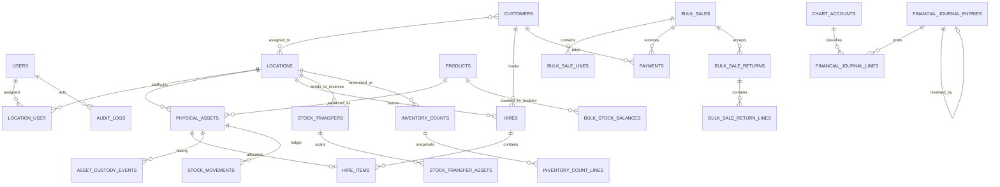

# Current data model overview

This is a compact guide to implemented tables, not a complete data dictionary. For column-level truth, use Laravel migrations under `database/migrations` and Eloquent models under `app/Models`.

Serialized assets store `current_location_id`, custody holder/type and a mutually exclusive current status. `asset_custody_events` and `stock_movements` record transitions; transfer dispatch puts custody in transit and receipt confirms destination. Hires reference their issue location and asset lines. Customer visibility for branch staff is mediated by `customer_location` and branch hires.

Bulk tracked products use `bulk_stock_balances` for on-hand, reserved, pending-inspection and damaged integer quantities per product/location. Bulk `stock_movements` retain receipt, adjustment, transfer, reservation, hire issue, return, inspection, cycle-count adjustment and sale/return history. `bulk_hire_returns` is an append-only, idempotent ledger of partial quantity returns and assessed penalties; returned good stock remains unavailable until inspection, while damaged stock remains segregated until repaired and released. Bulk hire reservations atomically increase the reserved balance; handover decrements reserved and on-hand together. `bulk_inventory_counts` and `bulk_inventory_count_lines` preserve expected balance snapshots and counted on-hand quantities; a second manager approves differences only after verifying that current on-hand, reserved, pending-inspection and damaged quantities still match the snapshot. `bulk_sales` and `bulk_sale_lines` snapshot branch, customer, seller, SKU/name and sale price, and use an idempotency key and request hash. Each sale links to its full `product_sale` receipt in `payments`. `bulk_sale_returns` and return lines preserve condition and returned quantity and link to append-only payment refunds; the same transaction restores good returns to pending inspection and damaged returns to the damaged balance.

## Integrity boundaries

- Unique product SKU and serialized asset code.
- Unique physical asset allocation in `hire_items`; transaction locks used during issue/return/inspection/transfer operations.
- Idempotency keys on stock movements, custody events, hires and transfer requests where implemented.
- Foreign key restrictions protect historical inventory and financial records from deletion.
- Financial amounts are stored in integer minor units. Hire receipts and append-only manual refunds use idempotency keys, branch scope and audit entries. Deposit applications are limited to their originating hire/order and source receipt. Operating expenses retain the separate approval/payment workflow for purchases settled that way. `vendor_bills` stores vendor invoices and due dates, and `vendor_bill_payments` records idempotent partial settlement. Expense invoices debit the selected expense account and credit supplier payables. Bulk receipt bills link the stock movement's existing inventory/payable journal without duplicating it. Serialized hire asset bills link one or more barcode records and reclass opening equity to supplier payables. `asset_depreciations` is unique by asset/month and posts straight-line book depreciation to expense and accumulated depreciation. `financial_journal_entries` and `financial_journal_lines` form balanced double-entry postings with source, actor, date and location; eligible entries can be reversed through separate offsetting entries. Period reconciliation includes current vendor payables, overdue vendor balances and period depreciation, but the management result remains cash basis and tax/statutory postings are not configured.
- Bulk stock movements and sale allocations are transactional and idempotent. Product and relevant location balances are locked during receipt, adjustment, transfer, hire reservation, handover, partial return, inspection, sale, sale return and cycle-count approval; operations cannot consume reserved, pending-inspection or damaged quantity. Adjustments require management authorization. Bulk cycle counts use a separate manager approval and recheck the captured balance snapshot before applying differences.
- Bulk sale and return requests are idempotent and transactional. Sale checkout can consume only available balance and records its full payment receipt atomically. Return quantities cannot exceed the unreturned amount for a sale line; the linked refund, return snapshot and stock restoration commit together. Generic payment refunds cannot bypass this stock return path.
- Cycle counts snapshot serialized assets assigned to one location. Each line retains the expected status and whether the barcode was scanned. Approval is a separate management action; it locks and rechecks every unscanned asset before moving it to missing custody and writing corresponding movement and audit rows. Count sessions and line snapshots are retained for reconciliation history.
- Bulk cycle counts snapshot all active bulk products at a branch, including zero balances. A separate manager approves quantity differences; the application rejects stale snapshots and quantities below reserved, pending-inspection or damaged stock. Each approved change is recorded in the stock movement and audit ledgers. A reasoned cancellation closes an unapproved count without changing stock.

This overview also covers the current CRM, custom-order, payment allocation, messaging, expense, staff permission and settings domains. For full column-level definitions and constraints, the migrations and models remain authoritative.
